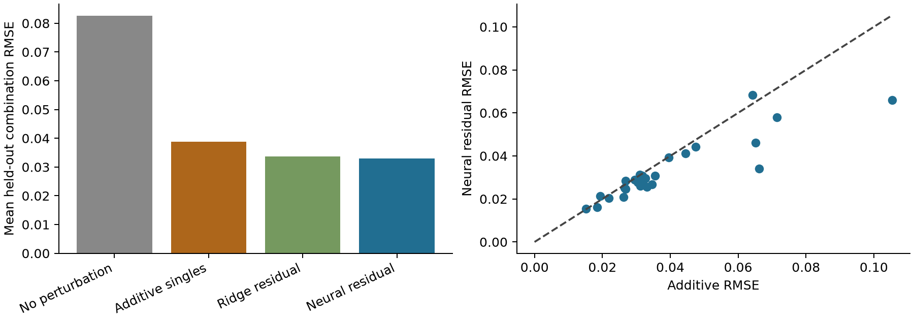
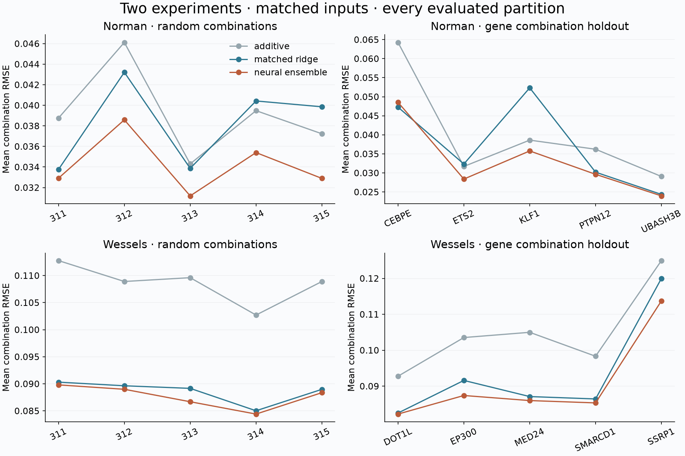

# Perturbation Composition Lab

[](https://github.com/aarnavbhat23/perturbation-composition-lab/actions/workflows/composition.yml)

Can measured single-gene responses predict an unseen two-gene combination?

This project aggregates **91,205 cells across 5,045 genes** from the GEARS-preprocessed Norman CRISPRa dataset. It compares no perturbation, single-gene additivity, a ridge residual model, and a permutation-invariant neural residual model. All cells belonging to a combination stay together; **26 complete combinations** are held out.



## Independent experiment and repeated partitions

The extension processes **30,707 primary THP1 cells**, four count lanes, **28 measured single-gene references and 158 two-gene combinations** from [Wessels et al. / CaRPool-seq](https://doi.org/10.1038/s41592-022-01705-x), [GEO GSE213957](https://www.ncbi.nlm.nih.gov/geo/query/acc.cgi?acc=GSE213957). Every metadata barcode joins the deposited count matrix. Gene selection uses control cells only. This Cas13 RNA-knockdown experiment is independent of the Norman CRISPRa dataset.



Mean condition RMSE across five random-combination splits:

| Experiment | Additive | Matched ridge | Neural ensemble |
|---|---:|---:|---:|
| Norman, 131 eligible pairs | 0.03918 | 0.03822 | 0.03419 |
| Wessels, 158 eligible pairs | 0.10857 | 0.08862 | 0.08764 |

The neural ensemble improves over additivity on all five random splits of both datasets. Its advantage over matched ridge is much smaller on Wessels. Raw errors are **not directly comparable across datasets**, which have different processing and intervention scales. Five additional partitions per dataset withhold all combinations involving each of the five highest-degree genes, while explicitly retaining that gene's measured single response. Neural does not beat ridge on every Norman gene holdout. On the Wessels SSRP1 holdout, even the neural model loses to the no-response control. The shuffled-residual control does not reproduce the random-311 neural gain.

These are **20 dependent partitions across two experiments**, not 20 independent datasets, and 60 fitted neural heads, not 60 independent biological observations. Each model has only 79–114 training combinations. Shared genes and low-count reference conditions (minimum 15 Wessels cells) limit conclusions. No unseen-gene, new-cell-type or cross-dataset model transfer claim is made. Models are fitted separately on each experiment.

```bash
python replication_replay.py  # every partition metric and fitted neural/ridge inference
python replication_inference.py MED24 EP300 --dataset wessels --output prediction.csv
python replication.py         # reruns missing partitions, checks existing ledgers
python plot_extension.py
# Rebuild the primary Wessels aggregation (about 0.8 GB compressed source):
python wessels_fetch.py
python wessels_prepare.py \
  --archive data/wessels-raw/GSE213957_THP1-CaRPool-seq_and_GSE213957_HEX293FTstabRNA.tar.gz \
  --metadata data/wessels-raw/GSE213957_THP1-CaRPool-seq.metadata.tsv.gz
```

Use a new `--output` directory for a full model refit. The cached rerun checks pair labels and held-out truth before reusing completed partitions. The included compact reference has means, counts, descriptive standard errors and genes; the cell ledger preserves lane, guide and original gene-pair labels. Both fitted heads receive identical symmetric features. Ridge coefficients, all neural checkpoints, preprocessing, exact profiles and traces are released per partition.

See [the extension protocol](docs/EXTENSION_PROTOCOL.md), [primary-source processing and attribution](data/WESSELS_ATTRIBUTION.md), and `results/replication/partition-results.csv`. Contemporary systems such as [GEARS](https://github.com/snap-stanford/GEARS) and [NAIAD](https://github.com/NeptuneBio/NAIAD) are related prior work; this is a matched-baseline audit, not a leaderboard comparison against them. The first-release experiment below is retained, including its slightly different ridge feature normalization; the extension fixes that mismatch.

## First-release result

| Model | Mean held-out combination RMSE | RMSE on the 20 most changed genes |
|---|---:|---:|
| No perturbation | 0.08263 | 0.79851 |
| Add measured single-gene responses | 0.03876 | 0.23789 |
| Ridge residual | 0.03363 | 0.18078 |
| Three-seed symmetric neural residual | 0.03291 | 0.18705 |

Errors use the upstream processed-expression scale. Targets are changes relative to control, not absolute expression correlations. The neural residual reduces mean condition error by 15.1% relative to additivity in this split. The simpler ridge model is close and is better on the selected top-20 metric. The top-20 gene set uses held-out truth **for evaluation only**; it is not known at inference.

The paired condition-bootstrap interval for neural-minus-additive RMSE is [-0.01018, -0.00265]. This resamples 26 conditions while keeping fitted models fixed; conditions sharing genes are dependent, and this is not an unconditional biological-replicate confidence interval. The repository also reports the neural-versus-ridge interval rather than implying superiority from a small point difference.

## Reproduce and use the model

```bash
python -m venv .venv
source .venv/bin/activate
python -m pip install -r requirements.txt
python -m unittest discover -s tests -v
python replay.py
python predict.py CBL CNN1 --output prediction.csv
# Full source reconstruction (allow about 2.5 GB disk space):
python fetch.py
python pseudobulk.py --data data/norman.h5ad
python benchmark.py
python plot.py
```

The compact pseudobulk reference, preprocessing arrays, trained heads, exact held-out profiles and metric tables are included. The large upstream cell matrix is downloaded separately. `predict.py` requires both genes to have measured single-gene reference profiles, rejects repeated/unknown genes, and returns processed-expression deltas for every supplied gene. It does not generate cells or predict arbitrary new perturbation genes.

## The experiment

1. Canonicalize perturbation order, treating `ctrl+GENE` and `GENE+ctrl` as the same single-gene condition. Stream 512-cell blocks from a backed AnnData file, retaining counts, means and descriptive standard errors. Cells are not counted as independent biological replicates.
2. Use 105 measured single-gene responses. There are 131 eligible two-gene combinations, randomly assigned by seed 311 to 79 train, 26 validation and 26 test conditions. Both single-gene references are available for every tested pair; this is a **known-gene, unseen-combination** experiment.
3. Fit a 32-dimensional PCA basis using measured singles and **training combinations only**. Regress the residual to additivity in this basis. Both ridge and neural models receive symmetric sum, absolute-difference and product features of the two single-gene embeddings. Train-only normalization is saved.
4. Train neural seeds 311/312/313, with validation-selected epochs 106/16/32. Average predicted residuals before reconstructing full-gene changes. Report every held-out condition, the additive baseline, top-20 errors and condition-level resampling.

The learned residual architecture is small because the supervised unit is a combination, of which only 79 are available for fitting. Calling the experiment a 91,205-example neural training set would overstate the effective sample size.

## A metadata issue worth checking

The downloaded GEARS file has `cell_type = A549`. The [original Norman experiment](https://pmc.ncbi.nlm.nih.gov/articles/PMC6746554/) describes K562 cells. This project records the inconsistency in `data/pseudobulk.manifest.json`, ignores the cell_type field, and does not reinterpret the experiment as an A549 intervention. The discrepancy is in this particular export; it is not evidence that the original experiment used the wrong cells.

## Artifacts

`pseudobulk.py` and its manifest pin the source file and aggregation. `results/split-ledger.csv` contains the exact combinations and cell counts. `results/heldout-profiles.npz` exposes truth and four model outputs over all 5,045 genes. `results/preprocessing.npz` stores the single-gene references and train-fitted basis needed for inference. `results/per-condition.csv`, `training-history.json` and `metrics.json` contain the completed experiment. `replay.py` recomputes both error metrics and independently reconstructs a held-out neural prediction from the released checkpoints.

## Context and limitations

[Norman et al., 2019](https://doi.org/10.1126/science.aax4438) and [GEARS](https://github.com/snap-stanford/GEARS) established this setting. [Simple controls exceed best deep learning algorithms…](https://doi.org/10.1093/bioinformatics/btaf317) motivates including strong simple controls. This repository is original code and a specific audit/reproduction experiment, not a new virtual-cell foundation model or a GEARS leaderboard result.

The initial experiment below used one combination split and one upstream processed dataset. The extension above adds repeated partitions and a primary independent dataset; both still use cell-aggregated responses. It does not test donor, lab, time, dose, cell-type transfer or unseen genes. Source selection and preprocessing may contribute to the result. Repeating split seeds and testing an independent experiment outrank adding more network layers.

Original code is MIT. Source data and derived expression references retain upstream provenance and terms; no ownership of the original experiment is claimed. The [exact public Dataverse source file](https://dataverse.harvard.edu/api/access/datafile/6154020) is the one used by the GEARS loader. The full raw export is not redistributed. Built with AI assistance; no independent review or adoption claim is implied.
